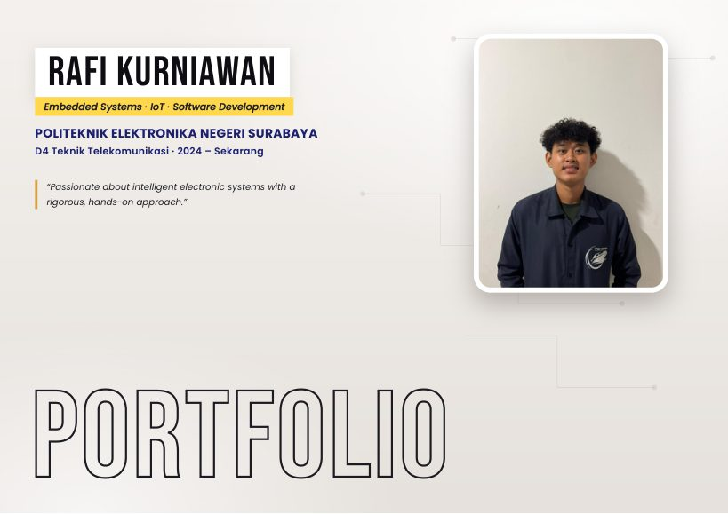
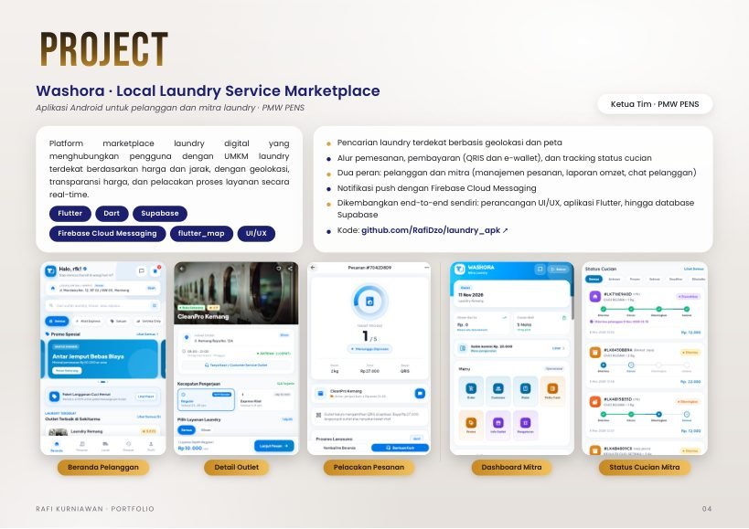
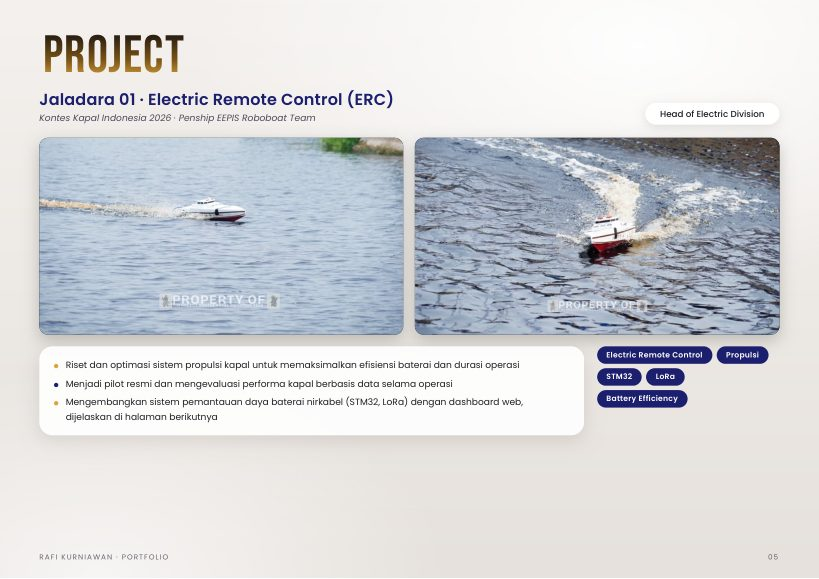
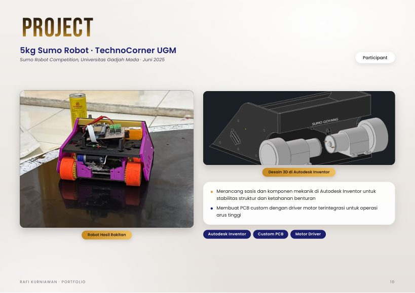

# Portofolio Rafi Kurniawan

Mahasiswa semester 5 D4 Teknik Telekomunikasi, Politeknik Elektronika Negeri Surabaya (PENS).
Fokus pada Embedded Systems, IoT, dan pengembangan perangkat lunak (Flutter, React.js, Supabase).

**[Buka portofolio (PDF)](Portofolio_Rafi_Kurniawan.pdf)**

| | |
|---|---|
|  |  |
|  |  |

## Isi portofolio

- **Washora**: aplikasi marketplace laundry (Flutter dan Supabase) untuk pelanggan dan mitra, dikembangkan dari UI/UX sampai database. Kode: [RafiDzo/laundry_apk](https://github.com/RafiDzo/laundry_apk)
- **Jaladara 01 (ERC, Kontes Kapal Indonesia 2026)**: sistem pemantauan daya baterai nirkabel (STM32, LoRa) dengan dashboard web
- **Robot arm 3 axis** (Flutter, WebSocket, ESP32) dan **deteksi kerusakan kardus** (YOLOv8)
- **Desain PCB dan mekanik**: sistem daya, kontroler robot, PCB kontroler ESP32 untuk autonomous car, sumo robot 5kg, water gate IoT, antena Wajanbolic
- **Jaringan**: simulasi topologi VLAN di Cisco Packet Tracer dan analisis paket ARP/ICMP dengan Wireshark
- Pengalaman organisasi, prestasi, dan sertifikat

## Kontak

- Email: krafi2320@gmail.com
- LinkedIn: [linkedin.com/in/rafikurniawan-id](https://www.linkedin.com/in/rafikurniawan-id/)
- GitHub: [RafiDzo](https://github.com/RafiDzo)
